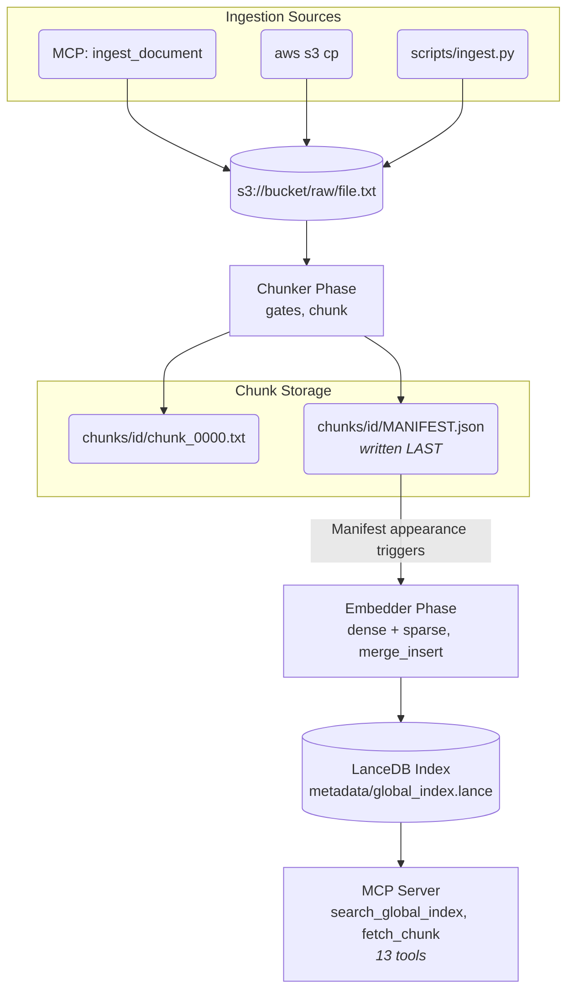

# OneBucket RAG demo

A small, complete retrieval-augmented-generation pipeline that you can read in
an afternoon: documents go in, get chunked and embedded (dense and sparse),
land in a [LanceDB](https://lancedb.com) index, and come back out through an
[MCP](https://modelcontextprotocol.io) server that Claude Desktop (or any MCP
client) uses to search, fetch and ingest. It is built on
[OneBucket](https://www.onebucket.io), an S3-compatible storage layer that
replicates one logical bucket across cloud providers and regions, and it shows
what that buys an AI pipeline: the same code, pointed at a OneBucket instead
of a single S3 bucket, gets multi-cloud placement, cache tiers and a
per-request event feed without a line changing.

The demo runs entirely on your machine: chunking, embedding and the MCP
server are local processes, and only the storage is remote. There are two
ways to trigger the local pipeline:

| Mode | Trigger | When to use it |
|---|---|---|
| `onebucket-events` *(the demo)* | OneBucket's **events** server reports each upload; a local consumer long-polls it | The OneBucket story: seconds to trigger, per-peer replication telemetry |
| `local-daemon` *(default)* | A local daemon polls `raw/` every few seconds | First contact with OneBucket or plain S3; no sign-in beyond an S3 key |

The compute does not have to be your laptop. The chunker and embedder are
two plain functions (`pipeline.chunk_and_write`, `pipeline.embed_and_commit`)
behind thin entry points, so they run anywhere you can host a Python
function and trigger it: AWS Lambda, a GPU cloud or another serverless
platform behind an API, a container on a schedule. The repository ships one
worked example, an AWS Lambda deployment (`lambda` mode, see
[Running the compute elsewhere](#running-the-compute-elsewhere)).

Storage is always object storage (a local directory for the quick start, AWS
S3, or a OneBucket). The index, the chunks and the raw documents all live
there; nothing is kept in a database server.

## How it works



Three ideas carry the design; the ADRs in `docs/architecture/decisions/`
explain each in full.

1. **One storage chokepoint, chosen by URI.** `src/onebucket_demo/storage.py`
   routes every read and write by scheme: `file://` to disk, `s3://` to
   boto3. boto3 reads `AWS_ENDPOINT_URL`, so the same call goes to AWS S3 or
   to a OneBucket depending on one environment variable.
2. **The manifest is the commit point.** The chunker writes every chunk
   file, then `MANIFEST.json` last. Everything downstream is triggered by
   the manifest, so the embedder runs exactly once per document and never
   sees a half-written one (ADR-012).
3. **Two shared pipeline functions, three triggers.** `pipeline.chunk_and_write`
   and `pipeline.embed_and_commit` are the only places chunking, embedding
   and index writes happen. The Lambda handlers and both daemons are thin
   wrappers; a test fails if any of them grows logic of its own (ADR-013).

Other things worth knowing before you read the code: chunks are 512 tokens
with a 50-token overlap, produced by a recursive paragraph → line → sentence
→ word splitter (ADR-009); embeddings are `BAAI/bge-small-en-v1.5` (dense,
384 dimensions) and `prithivida/Splade_PP_en_v1` (sparse) via fastembed; the
index stores pointers only, never chunk text (ADR-004); search returns two
ranked lists, semantic and keyword, and lets the model fuse them (ADR-005);
and a **canary hash** of the model versions is written into the index at
creation and checked by every reader, which stops you from querying an index
with a different model than wrote it.

## Quick start, in three steps of increasing commitment

Prerequisites: Python 3.11 or 3.12 and [`uv`](https://docs.astral.sh/uv/).

```bash
uv sync --all-extras
```

The first run of anything that embeds downloads two models (about 630 MB)
from the Hugging Face Hub into `~/.cache/fastembed`. It happens once; it is
also why the first search in a fresh environment takes a few seconds.

### Step 1: local filesystem, no accounts

```bash
bash scripts/run_demo.sh
```

Creates a local index under `data/metadata`, ingests the two sample
documents in `data/samples/`, and prints a hybrid search for "quarterly
revenue": a `semantic_matches` list, a `keyword_matches` list, and the time
spent inside the search. The finance report should outrank the lorem text in
both lists.

### Step 2: OneBucket (or any S3 bucket) with the polling daemon

You need an S3 access key for your OneBucket (console → Credentials) in an
AWS CLI profile, and two OneBuckets (console → Policies) named however you
like: one for documents and chunks, one for the index. The one rule that
matters is that they are **separate**, so the index replicates eagerly to
every peer while chunks fill lazily wherever they are read. Setup, and why
that split is the point of the demo, is in
[docs/operations/onebucket-setup.md](docs/operations/onebucket-setup.md).

```bash
export AWS_PROFILE=my-onebucket-profile
export AWS_ENDPOINT_URL=https://s3.onebucket.io          # the global S3 endpoint
export ONEBUCKET_CHUNK_ROOT=s3://my-data-onebucket/chunks
export ONEBUCKET_DATASET_ROOT=s3://my-meta-onebucket/metadata

uv run python scripts/init_index.py "$ONEBUCKET_DATASET_ROOT"   # once
bash scripts/start-pipeline-daemon.sh                             # leave running
```

In another terminal, upload a document and watch the daemon chunk and embed
it:

```bash
aws s3 cp data/samples/finance_report.txt s3://my-data-onebucket/raw/ --endpoint-url "$AWS_ENDPOINT_URL"
```

Then wire the MCP server into Claude Desktop (below) and ask it to search.

### Step 3: event-driven

**OneBucket events** (`onebucket-events`): sign in once in your browser, then
replace the polling daemon with the event consumer. It learns of each upload
from OneBucket's events server and records per-peer replication timing in
`.runbook-state/events.jsonl`.

```bash
uv run python scripts/onebucket-login.py       # one-time OAuth sign-in
bash scripts/start-event-consumer.sh           # instead of the polling daemon
```

Runbook: [docs/operations/runbooks/event-consumer.md](docs/operations/runbooks/event-consumer.md).

The modes are compared, with the exact variables each needs, in
[docs/operations/execution-modes.md](docs/operations/execution-modes.md).
Run one consumer per bucket at a time.

## Running the compute elsewhere

Nothing in the pipeline depends on running locally. To move it, host the
two phase functions wherever you like and call them on the same signals the
local consumers use: a new object under `raw/` runs
`pipeline.chunk_and_write`; a new `chunks/<id>/MANIFEST.json` runs
`pipeline.embed_and_commit`. If your platform exposes the functions behind
an HTTP API, the change on this side is one function: `dispatch_raw_object`
in `scripts/oneb_event_consumer.py` is the single place the consumer calls
the pipeline, so it can call your endpoint instead.

**Worked example: AWS Lambda** (`lambda` mode). One command builds two
container images, creates the roles, dead-letter queues and S3 triggers,
initialises the index and runs a smoke test:

```bash
bash scripts/deploy_aws.sh --bucket my-rag-bucket --region us-east-1 --profile my-aws-profile
```

Read [docs/operations/aws-deployment-runbook.md](docs/operations/aws-deployment-runbook.md)
first. Lambda mode works against plain AWS S3; it is not used in the live
OneBucket demo. Never leave its S3 triggers on a bucket that a local
consumer also processes, or every upload is processed twice
([cleanup](docs/operations/aws-prerequisites.md#cleanup) shows how to remove them).

## Connectors and endpoints

OneBucket exposes an S3 endpoint and two MCP servers, `data` (objects) and
`events` (the activity log). The **global** hostnames route each request to
the nearest live region and are the right default:

| Purpose | Hostname | Used by |
|---|---|---|
| S3 API | `https://s3.onebucket.io` | `AWS_ENDPOINT_URL` for every script and the MCP server |
| events MCP | `https://events.onebucket.io` | `ONEBUCKET_EVENTS_URL` for the event consumer; optionally a Claude connector |
| data MCP | `https://data.onebucket.io` | An optional Claude connector for browsing objects directly |

If your data must stay in one place, every live cluster also has regional
hostnames of the form `s3.<region>.onebucket.io`, `events.<region>.onebucket.io`
and `data.<region>.onebucket.io`, for example `s3.us-ashburn-1.onebucket.io`.
The current list of regions is on the support page:
**https://www.onebucket.io/support**. MCP servers are served at the root of
the hostname; do not append `/mcp`. The AWS region to configure is always
`us-east-1`; OneBucket uses it for request signing only.

Whichever hostnames you pick appear in four places. Keep them identical:

| Where | What to set |
|---|---|
| Your shell, when running the scripts | `AWS_ENDPOINT_URL`, `ONEBUCKET_EVENTS_URL` |
| Claude Desktop's `env` block for this repo's MCP server | the same two variables |
| `docs/demo_runbook/variables.yml` (live demo only) | `onebucket.s3_endpoint`, `onebucket.events_url`, `onebucket.data_url` |
| Claude's custom connectors (optional) | *Settings → Connectors → Add custom connector*, by URL; a connector's display name is its hostname |

## Wire the MCP server into Claude Desktop

The server speaks stdio and registers thirteen tools:

| Tool | Purpose |
|---|---|
| `search_global_index(query, limit, scope)` | Hybrid search; returns chunk pointers with scores. `scope` narrows a follow-up search to known documents. |
| `fetch_chunk(chunk_uri)` | The text of one chunk. |
| `ingest_document(source)` | Add a document by SEC ticker (latest 10-K), URL or local path; uploads to `raw/` and returns its `raw_file_id`. |
| `check_ingest_status(raw_file_id)` | Where a document is in the pipeline. |
| `list_documents()` | What is in the index. |
| `get_replication_metrics(raw_file_id)` | Per-peer write latency for one ingest, from the event log (`onebucket-events` mode). |
| `get_chunk_read_metrics(start_time, end_time, raw_file_id)` | Chunk fetch latency in a time window, from the event log. |
| `get_runbook_config()`, `set_runbook_variable(path, value)`, `validate_runbook_config()` | Read and edit the live demo's `variables.yml`. |
| `delete_document(raw_file_id)`, `purge_peer_cache(onebucket, peer_alias, key_pattern)`, `rebuild_index(confirm)` | Destructive recovery tools; each refuses on inconsistent state. |

The full reference, including the intended multi-hop workflow and the
destructive tools' safety rules, is
[docs/operations/mcp-tools-guide.md](docs/operations/mcp-tools-guide.md).

1. Open Claude Desktop's config file (`~/Library/Application Support/Claude/claude_desktop_config.json`
   on macOS, `%APPDATA%\Claude\claude_desktop_config.json` on Windows,
   `~/.config/Claude/claude_desktop_config.json` on Linux); create it with
   `{}` if missing.
2. Merge this into the top-level object (it may already hold other servers).
   For a OneBucket or S3 index:

   ```json
   {
     "mcpServers": {
       "onebucket-demo": {
         "command": "uv",
         "args": ["--directory", "/path/to/this/repo", "run", "python", "-m", "onebucket_demo.mcp_server"],
         "env": {
           "AWS_PROFILE": "my-onebucket-profile",
           "AWS_ENDPOINT_URL": "https://s3.onebucket.io",
           "ONEBUCKET_DATASET_ROOT": "s3://my-meta-onebucket/metadata",
           "ONEBUCKET_CHUNK_ROOT": "s3://my-data-onebucket/chunks",
           "ONEBUCKET_EXECUTION_MODE": "local-daemon"
         }
       }
     }
   }
   ```

   For the local filesystem index from step 1, the `env` block is just the
   two roots: `"ONEBUCKET_DATASET_ROOT": "/path/to/this/repo/data/metadata"`
   and `"ONEBUCKET_CHUNK_ROOT": "/path/to/this/repo/data/chunks"`.

   Your shell's exports do not reach Claude Desktop; everything the server
   needs must be in this `env` block. `ONEBUCKET_EXECUTION_MODE` tells
   `ingest_document` what will process an upload: in the two local modes it
   refuses to upload when no consumer heartbeat is present, because an upload
   nobody is watching would silently never be indexed.
3. Quit and relaunch Claude Desktop; it reads the config at startup.
4. Ask: *"Use the onebucket-demo tools to find chunks about quarterly
   revenue, fetch the top two, and summarise."*

## Run the tests

```bash
uv run pytest                 # everything (needs the models; ~40 s warm)
uv run pytest -m "not models" # the fast set CI runs on every push
```

Tests never touch a real AWS account or OneBucket: S3 is mocked with moto,
the events server with an in-process fake, and the suite clears
`AWS_ENDPOINT_URL`, `AWS_PROFILE` and every `ONEBUCKET_*` variable before each
test so your shell cannot leak in. Two tests guard the repository itself:
`tests/test_no_internal_refs.py` fails on anything that should not be
public, and `tests/test_docs_links.py` fails on a relative link that does
not resolve.

## Tuning knobs

| Knob | Default | Notes |
|---|---|---|
| `CHUNK_TOKEN_TARGET` / `CHUNK_TOKEN_OVERLAP` | 512 / 50 | `src/onebucket_demo/constants.py`; 512 matches both models' context (ADR-009). |
| `ONEBUCKET_EMBED_BATCH_SIZE` | 16 | Chunks per embedding batch; bounds memory (it keeps the Lambda example under its 3008 MB ceiling). |
| `ONEBUCKET_EVENTS_WAIT_SECONDS` | 60 | How long one `tail_events` long-poll waits (0 to 360). |
| `ONEBUCKET_DISABLE_CACHE_WARMER` | unset | Set to `1` to stop the MCP server pre-warming newly ingested documents. |

## Project structure

```
src/onebucket_demo/
  pipeline.py               chunk_and_write / embed_and_commit: the two phases every mode calls
  storage.py, _s3.py        URI-routed storage chokepoint; boto3 backend
  chunking.py               recursive cascade splitter
  embed_dense.py            BGE-small dense embeddings
  embed_sparse.py           SPLADE sparse embeddings + the canary hash
  schema.py                 the LanceDB table (pointers only)
  manifest.py               the chunker → embedder hand-off
  init_index.py             one-time, out-of-band table creation
  search.py                 hybrid search (the one implementation behind the tool)
  mcp_server.py             tool definitions and stdio transport
  mcp_tools.py              ingest, status, listing, metrics, config and recovery tools
  event_consumer.py         event parsing, validation, dedup and routing (pure logic)
  onebucket_auth.py         OAuth 2.1 PKCE client for the OneBucket MCP servers
  runbook_config.py         loader for the live demo's variables.yml
  lambda_handler_*.py       the two Lambda entry points (thin)
  gates.py, errors.py, constants.py, writer.py

scripts/
  run_demo.sh               step 1: local end-to-end demo
  init_index.py, ingest.py, run_mcp.py
  start-pipeline-daemon.sh, oneb_pipeline_daemon.py     local-daemon mode
  onebucket-login.py, start-event-consumer.sh, oneb_event_consumer.py   onebucket-events mode
  deploy_aws.sh, aws_deploy.py, build_*_image.sh, lock_lambda_deps.sh    the optional AWS Lambda example
  demo-setup.sh, demo_setup.py                          one-command setup for the live demo

docs/
  architecture/decisions/   ADRs: why the design is what it is
  operations/               setup for OneBucket and AWS, one runbook per mode, the MCP tool reference
  demo_runbook/             the scripted live demo, its config template and metrics
  demo-script.md            presenter walkthrough

infra/                      IAM policy templates, ECR and S3 notification config
lambda/                     the Lambda example's two Dockerfiles and locked requirements
tests/                      unit and integration tests, synthetic fixtures
data/samples/               two tiny documents for the local demo
```

## Documentation

| Doc | Purpose |
|---|---|
| [docs/operations/onebucket-setup.md](docs/operations/onebucket-setup.md) | Provision OneBucket: credentials, endpoints, policies, peers; what the modes mean |
| [docs/operations/execution-modes.md](docs/operations/execution-modes.md) | The three modes side by side; how to pick and switch |
| [docs/operations/runbooks/local-daemon.md](docs/operations/runbooks/local-daemon.md) | Operate the polling daemon |
| [docs/operations/runbooks/event-consumer.md](docs/operations/runbooks/event-consumer.md) | Operate the event consumer: sign-in, cursor, troubleshooting |
| [docs/operations/aws-deployment-runbook.md](docs/operations/aws-deployment-runbook.md) | First AWS deploy, end to end |
| [docs/operations/aws-manual-deploy.md](docs/operations/aws-manual-deploy.md) | The same deploy, step by step in the console and CLI |
| [docs/operations/aws-prerequisites.md](docs/operations/aws-prerequisites.md) | Tools, IAM permissions, cleanup |
| [docs/operations/aws-deployer-iam-setup.md](docs/operations/aws-deployer-iam-setup.md) | A least-privilege deployer user |
| [docs/operations/mcp-tools-guide.md](docs/operations/mcp-tools-guide.md) | Every tool, the multi-hop workflow, anti-patterns |
| [docs/demo-script.md](docs/demo-script.md) | Presenter walkthrough with prompts and narration |
| [docs/demo_runbook/onebucket_rag_demo_runbook.md](docs/demo_runbook/onebucket_rag_demo_runbook.md) | The scripted live demo an agent runs in Claude Desktop |
| [docs/demo_runbook/variables.example.yml](docs/demo_runbook/variables.example.yml) | Config template for the live demo |
| [docs/architecture/decisions/](docs/architecture/decisions/) | ADR-001 to ADR-013 |

## Limits of the demo

- Inputs are `.txt` and `.md` up to 10 MB; convert PDFs and HTML first
  (`ingest_document` converts HTML for you).
- Sparse search is a full scan with an in-memory dot product and the dense
  index is a flat scan; both are fine for thousands of chunks, not millions.
- Ingest is append-only: re-ingesting changed content creates a new document
  id, and `delete_document` is how you remove the old one.
- The event consumer and the polling daemon process one document at a time.

## License

MIT, see [LICENSE](LICENSE). Contributions welcome, see
[CONTRIBUTING.md](CONTRIBUTING.md).
Please report security issues privately, see [SECURITY.md](SECURITY.md).
